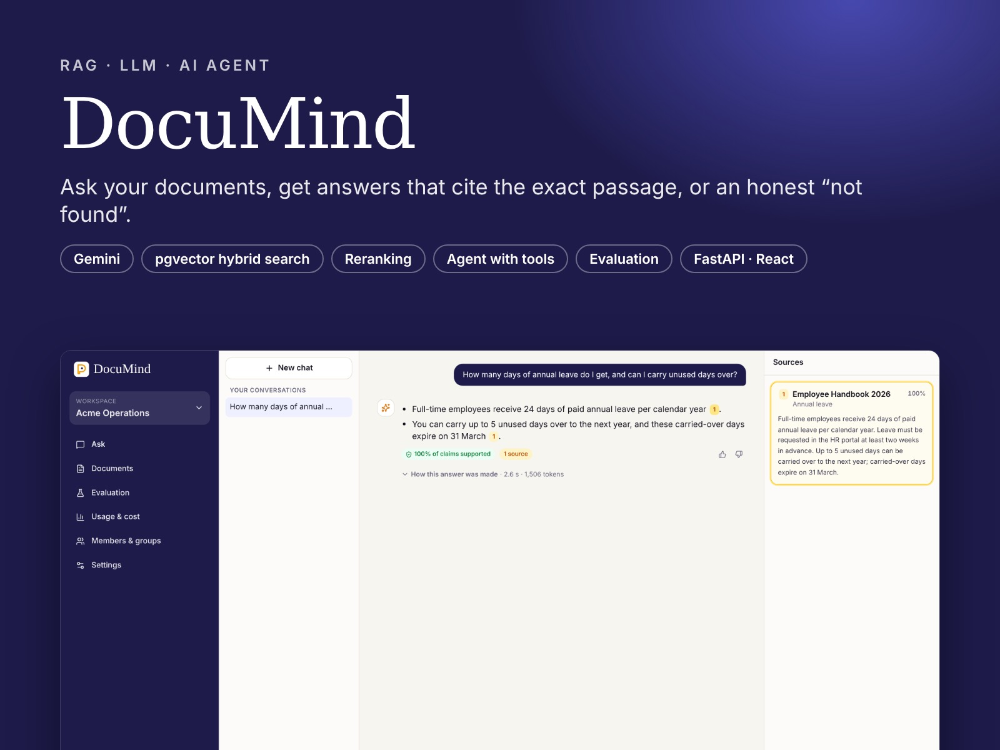

# DocuMind · ask your documents, get cited answers

DocuMind is a production-style **RAG (retrieval-augmented generation)** app. Teams upload PDFs, Word files, Markdown and web
pages into a workspace, then ask questions in plain language. Answers are written only from those documents, cite the exact
passage and page, and say "not found" instead of guessing.

**Live app:** https://documind-hz.vercel.app · **API docs:** https://documind-hz.vercel.app/api/docs



https://github.com/hfsachndio/documind/raw/main/docs/media/DocuMind-demo.mp4

## What it does

- **Ingestion pipeline**: parses PDF (per page), Word (with tables), Markdown, HTML and URLs; removes running headers,
  footers and page numbers; splits into heading-aware chunks with sentence overlap; keeps page and section metadata.
- **Embeddings + vector store**: `gemini-embedding-001` (768-d) with title/heading context, stored in **Postgres + pgvector** (HNSW).
- **Hybrid search + reranking**: pgvector semantic search and Postgres full-text search, merged with **reciprocal rank fusion**,
  then reranked by an LLM relevance judge (or a local cross-encoder in containers).
- **Grounded generation with citations**: Gemini answers only from numbered sources; every claim carries a clickable citation.
  Streaming responses; follow-up questions are rewritten into standalone queries.
- **Hallucination guardrails**: relevance threshold (refuses when nothing relevant is found), prompt-injection-resistant prompt,
  invalid citations stripped, and a **claim-by-claim faithfulness check** shown on every answer.
- **Agent mode**: the model plans and calls tools (search, list, read, compare documents, calculator) and shows each step.
- **Permission-aware retrieval (multi-tenant)**: workspaces, roles (owner / admin / member / viewer) and groups. Restricted
  documents are filtered **inside the SQL** of every search, so they can never reach the prompt or an answer.
- **Evaluation framework**: test questions with expected documents and reference answers; measures **hit rate, MRR, context
  precision, faithfulness, answer relevancy, correctness, abstention accuracy, latency p50/p95 and cost per question**, with
  run history charts. Export a run and cross-check it with the **RAGAS** library (`scripts/`).
- **Observability**: per-stage timings (embed, search, rerank, generate, verify), tokens and cost for every answer; usage dashboard.
- **API**: REST + OpenAPI (FastAPI) for everything the UI does, including streaming (SSE).

## Architecture

```
Upload/URL ─► parse ─► clean ─► chunk ─► embed (title+heading+text) ─► Postgres (pgvector HNSW + tsvector)
Question ─► rewrite ─► semantic ┐
                     keyword  ┴─► permission filter (SQL) ─► RRF ─► rerank ─► threshold ─► Gemini (cited) ─► verify
```

Details and design decisions: [docs/ARCHITECTURE.md](docs/ARCHITECTURE.md).

| Layer | Tech |
| --- | --- |
| LLM | Google Gemini (Flash for answers, Flash-Lite for rerank/verify/judge), provider-neutral interface |
| Embeddings | gemini-embedding-001, 768 dimensions, normalized |
| Vector + keyword search | PostgreSQL 16, pgvector (HNSW, cosine), full-text search (tsvector, ts_rank_cd) |
| Backend | Python 3.13, FastAPI, psycopg 3, pypdf, python-docx, BeautifulSoup, JWT + bcrypt |
| Frontend | React 19, TypeScript, Vite, Tailwind CSS |
| Hosting | Vercel (frontend + Python serverless API) and Neon Postgres, both on free tiers |
| AWS | Dockerfile + Terraform for App Runner, RDS PostgreSQL (pgvector), ECR and Secrets Manager ([deploy/aws](deploy/aws)) |
| Tests | pytest against real Postgres + pgvector (40 tests), Vitest + Testing Library, GitHub Actions |

## Run locally

```bash
# 1. Database: Postgres 15+ with pgvector, e.g.
docker compose up db -d

# 2. API
python -m venv .venv && . .venv/bin/activate
pip install -r requirements-dev.txt
cp .env.example .env            # set DATABASE_URL, JWT_SECRET, optionally GEMINI_API_KEY
cd server && uvicorn documind.main:app --reload --port 8000

# 3. Web app
cd web && npm ci && npm run dev  # http://localhost:5173
```

Without `GEMINI_API_KEY` the app runs with a deterministic offline provider (hashed bag-of-words embeddings and extractive
answers), so everything works without any key; with a key it uses Gemini. Or run the full stack in one container:
`docker compose up --build` → http://localhost:8000.

## Tests

```bash
cd server && pytest -q     # ingestion, chunking, SSRF protection, RRF, citations, calculator safety, auth, roles,
                           # workspace isolation, permission-aware retrieval (RAG + agent), streaming, evaluation, usage
cd web && npm test         # answer rendering (no raw HTML), citations, verification badge, charts, landing page
```

## Configuration

| Variable | Default | Purpose |
| --- | --- | --- |
| `DATABASE_URL` | local | Postgres with pgvector |
| `JWT_SECRET` | derived | session signing key; when unset it is derived from `DATABASE_URL` (set your own 32+ chars to rotate sessions independently) |
| `GEMINI_API_KEY` | — | enables Gemini; free key at aistudio.google.com |
| `CHAT_MODEL` / `FAST_MODEL` | `gemini-flash-latest` / `gemini-flash-lite-latest` | answer model / rerank, verify, judge model |
| `RERANKER` | `llm` | `llm`, `cross-encoder` (containers), `lexical`, `none` |
| `TOP_K`, `RETRIEVE_CANDIDATES`, `MIN_RELEVANCE` | 6, 30, 0.35 | retrieval depth and refusal threshold |
| `CHUNK_TOKENS`, `CHUNK_OVERLAP` | 350, 60 | chunking |
| `QUESTIONS_PER_HOUR` | 60 | per-user rate limit |

## Security

Passwords hashed with bcrypt; JWT sessions; every workspace route checks membership and role; document visibility enforced in
SQL; URL ingestion blocks private, loopback and cloud-metadata addresses and re-checks every redirect; the answer renderer never
renders raw HTML from the model; the agent's calculator evaluates arithmetic only; uploads are size-limited and type-checked.

---

Designed and developed by **Hafsah Zulfiqar**.
