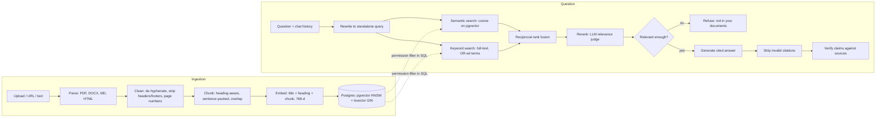

# DocuMind architecture

DocuMind is a permission-aware retrieval-augmented generation (RAG) system: users upload documents into workspaces,
ask questions in plain language, and get answers written only from those documents, with citations.

## Components

| Path | Responsibility |
| --- | --- |
| `server/documind/ingest/parsers.py` | PDF (pypdf, per page), Word (python-docx incl. tables), Markdown, HTML (strips nav/scripts), URL fetch with SSRF protection |
| `server/documind/ingest/chunker.py` | Cleaning, boilerplate removal, heading-aware chunking with sentence overlap |
| `server/documind/ingest/pipeline.py` | Parse → chunk → contextual embeddings → store → 2-sentence summary; failures are recorded, never half-indexed |
| `server/documind/retrieval/search.py` | Permission-filtered vector + keyword search, RRF fusion, reranking (LLM / cross-encoder / lexical) |
| `server/documind/rag/answer.py` | Query rewriting, grounded prompt, streaming, citation validation, refusal and faithfulness guardrails |
| `server/documind/agent/agent.py` | Tool-using agent (search, list, read, compare, calculate) with a step trace |
| `server/documind/evals/metrics.py` | Hit rate, MRR, context precision, faithfulness, relevancy, correctness, abstention, latency, cost |
| `server/documind/llm/` | Provider-neutral interface: Gemini over REST (retries, rate-limit back-off) and a deterministic offline provider for tests |
| `server/documind/security.py` | bcrypt passwords, JWT sessions, roles, group-based document visibility (`visible_sql`) |
| `web/` | React + TypeScript UI: chat with citations and traces, documents, evaluation dashboard, usage, members and groups |

## Design decisions

**Chunking.** Chunks are ~350 tokens, packed from whole sentences, with ~60 tokens of sentence overlap inside a section
and a hard break at every heading so a chunk stays on one topic. Each chunk keeps its page and heading so citations can
say *Handbook, p. 4 · Annual leave*. Repeated running headers/footers and page numbers are removed before chunking.

**Contextual embeddings.** The embedded text is `title + heading + chunk`. Short chunks like "Up to 5 days can be carried
over" are otherwise ambiguous; the prefix tells the embedding what they are about.

**Hybrid retrieval.** Semantic search finds paraphrases ("time off" ≈ "annual leave"); keyword search finds exact terms,
codes and names that embeddings blur. Results are merged with reciprocal rank fusion (k = 60), which needs no score
calibration between the two retrievers.

**Reranking.** The top fused candidates are scored by a fast LLM acting as a relevance judge (one call, all passages).
On serverless this avoids shipping a 200 MB model; containers can switch to a local cross-encoder (`RERANKER=cross-encoder`).
If the reranker is unavailable the system falls back to lexical scoring instead of failing.

**Guardrails against hallucination.**
1. *Retrieval threshold*: if no passage passes `MIN_RELEVANCE`, the model is never called; the user gets "not found".
2. *Grounded prompt*: answer only from numbered sources, cite every factual sentence, treat source text as data (prompt-injection resistance).
3. *Citation validation*: citations to sources that weren't provided are removed; an answer with no citations is flagged.
4. *Claim verification*: a second pass splits the answer into claims and checks each against the sources; the UI shows the
   supported share and lists unsupported claims.

**Permission-aware retrieval.** Visibility is enforced inside the SQL of every retrieval query (`visible_sql`), *before*
ranking, so restricted chunks are never candidates, never sent to the LLM and never cited. Owners and admins see all documents;
others see workspace-wide documents plus those shared with their groups. The agent's tools use the same functions, and the
test suite checks the restricted path through the library, direct document access, plain RAG and agent mode.

**Evaluation.** Test questions can carry an expected document (retrieval metrics) and a reference answer (correctness).
Questions with neither are *unanswerable* and measure abstention. Runs execute one case per request so they fit serverless
time limits and free-tier rate limits. `scripts/export_eval.py` + `scripts/ragas_eval.py` cross-check results with the RAGAS library.

**Observability and cost.** Every question logs per-stage latency (embed, search, rerank, generate, verify), tokens and the
equivalent paid cost; the Usage page aggregates p50/p95 latency, answer rate, cost and feedback.

## Data model

`users`, `workspaces`, `memberships(role)`, `groups`, `group_members`, `invites`, `documents(access)`, `document_groups`,
`chunks(embedding vector(768), tsv tsvector)`, `conversations`, `messages(citations, trace, feedback)`, `query_logs`,
`eval_cases`, `eval_runs`. See `server/documind/schema.sql`.

## Scaling notes

- HNSW index with `ef_search = 100`; on pgvector ≥ 0.8 `iterative_scan` keeps scanning until enough rows pass the permission filter.
- Ingestion is synchronous (fine for files up to a few MB on serverless). For large volumes, move `ingest()` to a queue worker
  (SQS + Lambda/Fargate); the function is already idempotent per document.
- Embeddings are batched (50 per request) with retry and server-suggested back-off for rate limits.
- Swap providers by implementing `Provider` (Bedrock, OpenAI, a local model); dimensions are fixed at 768 in the schema.
